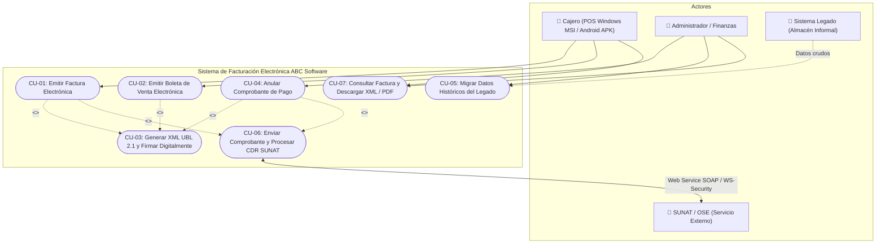

# DOCUMENTO DE CASOS DE USO - SISTEMA DE FACTURACIÓN ELECTRÓNICA
**Proyecto:** ABC Software Corp  
**Módulo:** Fase 1 - Spec-First  
**Normativa:** SUNAT / OASIS UBL 2.1  

---

## 1. Identificación y Descripción de Actores

* **Cajero (Operador de Punto de Venta):**  
  Usuario operativo que interactúa desde las terminales de caja locales (tanto en la aplicación de escritorio Windows `.MSI` como en dispositivos móviles Android `.APK`). Es responsable de seleccionar productos, registrar el RUC del cliente, aplicar descuentos permitidos, procesar el pago e imprimir la representación impresa (ticket de 80mm).
* **Administrador de Tienda / Finanzas:**  
  Usuario con privilegios gerenciales y contables. Gestiona certificados digitales X.509, configura series correlativas (`F001`, `B001`), autoriza y ejecuta solicitudes de anulación de comprobantes (comunicación de baja o notas de crédito) y es el responsable de ejecutar la ingesta y saneamiento de datos históricos del almacén informal.
* **SUNAT / OSE (Operador de Servicios Electrónicos):**  
  Actor externo gubernamental/regulatorio. Expone servicios web (SOAP / MTOM) para la recepción de paquetes comprimidos `.ZIP` conteniendo el XML UBL 2.1 firmado. Valida las reglas de negocio tributarias y emite la Constancia de Recepción (CDR) con el resultado (`ACEPTADO`, `RECHAZADO`, `OBSERVADO`).
* **Sistema Legado de Almacén:**  
  Sistema preexistente no formalizado que contiene la base histórica de clientes empíricos, inventario de artículos y registros de ventas anteriores necesarios para la migración.

---

## 2. Diagrama de Casos de Uso (Mermaid)

---

## 3. Especificación Detallada de Casos de Uso Críticos

### CU-03: Generación del XML UBL 2.1 a partir de los datos de la factura
* **Identificador:** `CU-03`
* **Tipo:** Caso de uso de Dominio / Transformación Tecnológica
* **Invocador:** `CU-01` (Emitir Factura), `CU-02` (Emitir Boleta), `CU-04` (Anular Comprobante)
* **Precondición:** 
  1. Comprobante registrado en la base de datos con serie y correlativo reservado atómicamente (ej. `F001-00000123`).
  2. Datos del emisor y receptor validados fiscalmente (RUC válido con checksum de Módulo 11).
  3. Certificado digital tributario X.509 v3 disponible y cargado en el almacén de seguridad.
* **Flujo Principal:**
  1. El caso de uso recupera el modelo de dominio `Factura` con los parámetros peruanizados: `rucEmisor`, `ubigeoEmisor`, `tipoDocumentoIdentidad`, `ubigeo` del cliente y el desglose de bases imponibles y tributos (IGV, ISC, ICBPER).
  2. Instancia el componente `UBLGenerator`.
  3. Se inicializa el documento XML con el namespace principal OASIS `urn:oasis:names:specification:ubl:schema:xsd:Invoice-2` y prefijos requeridos (`cac`, `cbc`, `ext`, `ds`).
  4. Mapea la cabecera normativa estricta de SUNAT Perú:
     * `<cbc:UBLVersionID>`: Valor fijo mandatorio **`2.1`**.
     * `<cbc:CustomizationID>`: Valor fijo mandatorio **`2.0`**.
     * `<cbc:ID>`: Identificador legal determinístico resultante de concatenar `{serie}-{correlativo:08d}` (ej. **`F001-00000123`**). Se prohíbe el uso de UUIDs.
     * `<cbc:IssueDate>` (YYYY-MM-DD), `<cbc:IssueTime>` (HH:MM:SS), `<cbc:InvoiceTypeCode listID="0101">01</cbc:InvoiceTypeCode>` (Catálogo 01 y 51) y `<cbc:DocumentCurrencyCode>` (`PEN` o `USD` según Catálogo 02).
  5. Mapea `cac:AccountingSupplierParty` con el `rucEmisor` (`@schemeID="6"`), razón social y `ubigeoEmisor`. Mapea `cac:AccountingCustomerParty` con el `tipoDocumentoIdentidad` (`@schemeID="6"`), número de RUC del cliente, razón social y `ubigeo`.
  6. Construye `cac:TaxTotal` con subtotales independientes para:
     * IGV (código `1000`, categoría `VAT`).
     * ISC (código `2000`, categoría `EXC`, si aplica).
     * ICBPER (código `7152`, categoría `OTH`, impuesto a las bolsas de plástico según Ley N° 30884).
  7. Construye `cac:LegalMonetaryTotal` con `LineExtensionAmount` (base gravada), `TaxInclusiveAmount` (total con tributos) y `PayableAmount` (importe total a cobrar).
  8. Itera cada ítem en nodos `cac:InvoiceLine`, vinculando `InvoicedQuantity` (Catálogo 03), `Price` (valor unitario), `PricingReference` (precio unitario con IGV según Catálogo 16 = '01'), `codigoAfectacionIgv` (**Catálogo 07 de SUNAT**, ej. `10` Gravado Oneroso) y `codigoSistemaIsc` (**Catálogo 08 de SUNAT**, ej. `01` Al Valor).
  9. Canonicaliza el XML (C14N) e inyecta la Firma Digital XML-DSig en `/Invoice/ext:UBLExtensions/ext:UBLExtension/ext:ExtensionContent`.
  10. Extrae el `DigestValue` (Hash SHA-256 Base64) para el código QR y la representación PDF.
  11. Valida el XML generado contra el archivo de validación sintáctica `UBL-Invoice-2.1.xsd`.
* **Postcondición:**
  * Archivo XML físico generado con nomenclatura oficial SUNAT: `20123456789-01-F001-00000123.xml`.
  * Hash SHA-256 persistido en base de datos.
  * Factura actualizada al estado `XML_GENERADO_FIRMADO`.

---

### CU-01: Emitir Factura Electrónica
* **Identificador:** `CU-01`
* **Actor Principal:** Cajero (Terminal POS Windows o Android)
* **Precondición:** 
  1. Sesión de caja abierta en terminal POS.
  2. Adquirente cuenta con RUC válido (Catálogo 06 = `6`).
* **Flujo Principal:**
  1. El cajero ingresa el RUC del cliente; el sistema autocompleta la razón social y dirección fiscal desde el caché local o servicio de consulta.
  2. El cajero agrega los productos y define cantidades y descuentos.
  3. El motor de dominio calcula en tiempo real los importes gravados, exonerados, IGV (18%), ISC e ICBPER.
  4. Se define la modalidad de pago: "Contado" o "Crédito" (con desglose de cuotas y fechas de vencimiento).
  5. El cajero confirma la emisión. El sistema bloquea y reserva el siguiente número correlativo de la serie `F001`.
  6. Persiste la entidad `Factura` en la base de datos relacional.
  7. Ejecuta de forma automática el caso de uso `CU-03` para generar y firmar el XML UBL 2.1.
  8. Encola y transmite el paquete comprimido `.ZIP` hacia el Web Service de SUNAT/OSE (`CU-06`).
  9. Recibe la Constancia de Recepción (CDR), valida que el código sea `0` y actualiza la factura a `ACEPTADA`.
  10. Emite el ticket de venta con código QR y Hash del comprobante.
* **Postcondición:** Factura emitida formalmente ante SUNAT con CDR almacenado y stock de almacén rebajado.

---

### CU-05: Migrar Datos Históricos del Legado
* **Identificador:** `CU-05`
* **Actor Principal:** Administrador de Tienda / Finanzas
* **Precondición:** Lote de migración extraído del sistema informal de almacén disponible en formato estructurado.
* **Flujo Principal:**
  1. El Administrador envía el payload de datos históricos mediante el endpoint `/api/v1/migracion/legado`.
  2. El sistema abre una sesión de migración transaccional con aislamiento.
  3. **Saneamiento de Clientes:**
     * Aplica el algoritmo matemático **Módulo 11** a cada número de documento.
     * Convierte identificadores antiguos al código formal de Catálogo 06 (`6` para RUC, `1` para DNI).
     * Corrige caracteres ilegales o saltos de línea en razones sociales.
  4. **Saneamiento de Catálogo de Productos:**
     * Homologa las unidades empíricas ("unid", "paq", "mtr") a la codificación internacional del Catálogo 03 (`NIU`, `PK`, `MTR`).
     * Asigna a cada producto la afectación de IGV predeterminada (`10` Gravado).
     * Genera SKUs normalizados para productos que carecían de identificador formal.
  5. Inserta en bloque los registros validados en la base de datos formal.
  6. Registra en bitácora de auditoría los registros defectuosos rechazados (ej. RUCs con longitud errónea).
  7. Retorna el resumen del procesamiento (procesados, insertados, rechazados con detalle).
* **Postcondición:** Datos del almacén informal migrados y normalizados para la emisión de facturación formal.
