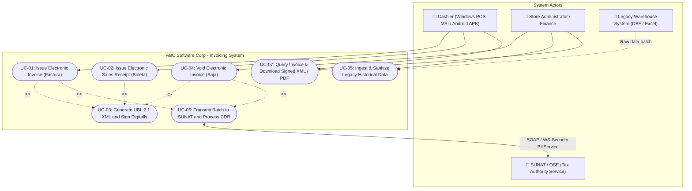

# USE CASE SPECIFICATION - ELECTRONIC INVOICING SYSTEM
**Company:** ABC Software Corp  
**Phase:** Phase 1 - Spec-First  
**Standard:** OASIS UBL 2.1 (`UBL-Invoice-2.1.xsd`)  
**Regulatory Framework:** SUNAT (Perú)  

---

## 1. Actor Identification and Description

* **Cashier (Operador de Punto de Venta):**  
  Usuario operativo que interactúa desde las terminales de venta (aplicación de escritorio Windows `.MSI` o tablet Android `.APK`). Registra los productos del catálogo, captura el número de documento de identidad del cliente (`identityDocumentNumber`), calcula tributos en tiempo real y emite los comprobantes electrónicos imprimiendo la representación gráfica (ticket de 80mm).
* **Store Administrator / Finance (Administrador de Tienda y Finanzas):**  
  Usuario con privilegios gerenciales y contables. Gestiona certificados digitales X.509 v3, configura series correlativas (`series`, ej. `F001`, `B001`), autoriza y procesa solicitudes de anulación (`VoidInvoiceInput` mediante comunicación de baja) y ejecuta la migración masiva de datos históricos desde el almacén informal (`LegacyMigrationInput`).
* **SUNAT / OSE (Peruvian Tax Authority & Electronic Service Operator):**  
  Actor externo gubernamental y regulador. Expone servicios web SOAP con seguridad WS-Security para la recepción de paquetes comprimidos `.ZIP` conteniendo el archivo XML UBL 2.1 firmado. Valida la conformidad normativa y retorna la Constancia de Recepción (CDR) con el estado oficial (`ACEPTADO`, `RECHAZADO`, `OBSERVADO`).
* **Legacy System (Informal Warehouse System):**  
  Sistema preexistente no formalizado que provee la información histórica de clientes empíricos, inventario de artículos y registros de ventas anteriores para su ingesta y saneamiento.

---

## 2. Use Case Diagram (Mermaid)

---

## 3. Detailed Specification of Critical Use Cases

### UC-03: Generate UBL 2.1 XML Document and Digital Signature
* **Use Case ID:** `UC-03`
* **Type:** Core Domain / Technological Transformation
* **Triggered by:** `UC-01` (Issue Electronic Invoice), `UC-02` (Issue Electronic Sales Receipt), `UC-04` (Void Electronic Invoice)
* **Preconditions (Precondiciones):** 
  1. Comprobante registrado en base de datos con serie (`series`) y correlativo (`sequenceNumber`) atómicamente asignados (ej. `F001` y `123`).
  2. RUC del emisor (`issuerRuc`) y adquirente (`identityDocumentNumber`) validados con el algoritmo Módulo 11 de SUNAT.
  3. Certificado digital tributario X.509 v3 disponible en almacén seguro.
* **Main Success Scenario (Flujo Principal):**
  1. El caso de uso recupera el modelo de dominio `InvoiceInput` con los parámetros técnicos de SUNAT: `issuerRuc`, `issuerUbigeo`, `identityDocumentType` (Catálogo 06 = '6'), `ubigeo` del cliente y el desglose de bases imponibles y tributos (IGV, ISC, ICBPER).
  2. Instancia el componente especializado `UBLGenerator`.
  3. Inicializa el documento XML bajo el namespace raíz OASIS `urn:oasis:names:specification:ubl:schema:xsd:Invoice-2` y prefijos requeridos (`cac`, `cbc`, `ext`, `ds`).
  4. Mapea la cabecera normativa estricta de SUNAT Perú:
     * `<cbc:UBLVersionID>`: **`2.1`** (valor fijo mandatorio).
     * `<cbc:CustomizationID>`: **`2.0`** (valor fijo mandatorio).
     * `<cbc:ID>`: Identificador legal determinístico resultante de concatenar `{series}-{sequenceNumber:08d}` $\rightarrow$ **`F001-00000123`** (se prohíbe el uso de UUIDs aleatorios).
     * `<cbc:IssueDate>` (`issueDate`), `<cbc:IssueTime>` (`issueTime`), `<cbc:InvoiceTypeCode listID="0101">01</cbc:InvoiceTypeCode>` (Catálogo 01 y 51) y `<cbc:DocumentCurrencyCode>` (`currencyCode`, ej. `PEN` según Catálogo 02).
  5. Mapea `cac:AccountingSupplierParty` con `issuerRuc` (`@schemeID="6"`), razón social y `issuerUbigeo`. Mapea `cac:AccountingCustomerParty` con `identityDocumentType` (`@schemeID="6"`), número de RUC del adquirente, razón social y `ubigeo`.
  6. Construye los bloques globales en `cac:TaxTotal` con subtotales independientes para:
     * IGV (código `1000`, categoría `VAT`).
     * ISC (código `2000`, categoría `EXC`, si aplica).
     * ICBPER (código `7152`, categoría `OTH`, bolsas de plástico Ley N° 30884).
  7. Construye `cac:LegalMonetaryTotal` con `LineExtensionAmount` (base gravada), `TaxInclusiveAmount` (precio total con impuestos) y `PayableAmount` (monto total a pagar por el adquirente).
  8. Itera cada ítem en nodos `cac:InvoiceLine`, vinculando `InvoicedQuantity` (`unitOfMeasure` según Catálogo 03), `Price` (`unitValue`), `PricingReference` (`unitPriceWithIgv` según Catálogo 16 = '01'), afectación al IGV (`igvTaxExemptionCode` según **Catálogo 07 de SUNAT**, ej. `10` Gravado Oneroso) y sistema de cálculo del ISC (`iscCalculationSystemCode` según **Catálogo 08 de SUNAT**, ej. `01` Al Valor).
  9. Canonicaliza el árbol XML (C14N) e inyecta la firma digital XML-DSig (`enveloped`) en `/Invoice/ext:UBLExtensions/ext:UBLExtension/ext:ExtensionContent`.
  10. Extrae el `DigestValue` (resumen criptográfico Hash SHA-256 en Base64) para la generación del código QR y la representación en PDF.
  11. Valida el XML generado contra el archivo XSD oficial `UBL-Invoice-2.1.xsd`.
* **Postconditions (Postcondiciones):**
  * Archivo XML generado con la nomenclatura oficial de SUNAT: `20123456789-01-F001-00000123.xml`.
  * Hash SHA-256 (`digestValue`) persistido para emisión de comprobante y código QR.
  * Factura actualizada al estado `XML_GENERADO_FIRMADO`.

---

### UC-01: Issue Electronic Invoice (Emitir Factura Electrónica)
* **Use Case ID:** `UC-01`
* **Primary Actor:** Cashier (Terminal POS Windows o Android)
* **Preconditions (Precondiciones):** 
  1. Sesión de caja abierta en la terminal POS con serie `series` habilitada (`F001`).
  2. Adquirente identificado con RUC válido (`identityDocumentType` = `'6'`).
* **Main Success Scenario (Flujo Principal):**
  1. El cajero ingresa el RUC del cliente (`identityDocumentNumber`); el sistema consulta el padrón y autocompleta razón social (`legalName`), dirección fiscal (`fiscalAddress`) y `ubigeo`.
  2. El cajero agrega productos del catálogo, especificando cantidades y descuentos comerciales.
  3. El motor de dominio (`CalculadorTributosPeruanos`) calcula en tiempo real las bases gravadas, exoneradas, IGV (18%), ISC e ICBPER.
  4. Se define la condición de pago: "Contado" o "Credito" (con desglose de cuotas y fechas de vencimiento en `paymentTerms`).
  5. El cajero confirma la emisión. El sistema reserva atómicamente el siguiente número correlativo (`sequenceNumber`).
  6. Se persiste la factura en base de datos.
  7. Invoca automáticamente a `UC-03` para la generación y firmado digital del XML UBL 2.1.
  8. Se comprime en formato `.ZIP` y se envía al Web Service de SUNAT/OSE (`UC-06`).
  9. Recibe la Constancia de Recepción (CDR), valida que el código de respuesta sea `0` (Aceptado) y actualiza el estado a `ACEPTADA`.
  10. Emite el ticket de venta de 80mm con código QR y Hash del comprobante.
* **Postconditions (Postcondiciones):** Factura emitida formalmente ante SUNAT con CDR almacenado y stock de almacén actualizado.

---

### UC-05: Ingest & Sanitize Legacy Historical Data (Migración de Datos del Legado)
* **Use Case ID:** `UC-05`
* **Primary Actor:** Store Administrator / Finance
* **Preconditions (Precondiciones):** Lote de migración extraído del sistema informal de almacén estructurado según el schema `LegacyMigrationInput`.
* **Main Success Scenario (Flujo Principal):**
  1. El Administrador envía el lote histórico mediante el endpoint `POST /api/v1/migration/legacy`.
  2. El sistema inicia una transacción de migración con aislamiento.
  3. **Saneamiento de Clientes:**
     * Aplica el algoritmo matemático **Módulo 11** a cada número de documento (`identityDocumentNumber`).
     * Homologa tipos antiguos al código formal del Catálogo 06 (`6` para RUC, `1` para DNI).
     * Corrige caracteres ilegales o saltos de línea en razones sociales (`legalName`).
  4. **Saneamiento de Catálogo de Productos:**
     * Homologa unidades empíricas (`legacyUnitOfMeasure`, ej. 'unid', 'mtr') a la codificación internacional del Catálogo 03 (`unitOfMeasure`: `NIU`, `MTR`).
     * Asigna a cada producto la afectación de IGV sugerida (`suggestedIgvTaxExemptionCode` según Catálogo 07: `10` Gravado).
     * Asigna SKUs normalizados (`productCode`).
  5. Inserta en bloque los registros validados en la base de datos relacional formal.
  6. Registra en bitácora de auditoría los registros defectuosos rechazados (`sanitizationErrors`).
  7. Retorna la respuesta `LegacyMigrationResponse` con el conteo de registros procesados, migrados y rechazados.
* **Postconditions (Postcondiciones):** Datos históricos del almacén informal migrados y homologados para emitir comprobantes de pago formales.
