# SOFTWARE ARCHITECTURE DOCUMENT (CLEAN MVC WITH HEXAGONAL VISION)
**Company:** ABC Software Corp  
**Phase:** Phase 1 - Spec-First  
**Pattern:** Clean Modular Monolith MVC with Ports & Adapters (Hexagonal Architecture)  
**Cross-Platform Delivery:** Windows Desktop (.MSI) and Android Mobile (.APK)  

---

## 1. Architectural Strategy & Vision (Estrategia y Visión Arquitectónica)

El sistema de facturación electrónica de **ABC Software Corp** se diseña inicialmente como un **Monolito Modular Limpio** basado en **MVC (Modelo-Vista-Controlador)**, pero desacoplado estrictamente con **Arquitectura Hexagonal (Puertos y Adaptadores)** y **Clean Architecture**.

### Principios de Diseño:
1. **Separación de Responsabilidades:** La lógica de cálculo tributario peruano (IGV 18%, ISC, ICBPER) y las reglas de validación de SUNAT se encuentran en el **Núcleo de Dominio (Domain Core)**, completamente aisladas de protocolos de transporte (HTTP REST) y motores de base de datos.
2. **Capacidad de Evolución:** Al interactuar a través de **Puertos de Entrada (Input Ports)** y **Puertos de Salida (Output Ports)**, cualquier módulo puede migrarse a un microservicio independiente sin modificar las reglas de negocio.
3. **Contrato Formal Spec-First:** La comunicación entre clientes nativos y el servidor se rige por el contrato OpenAPI 3.0.3 en inglés (`openapi.yaml`).

---

## 2. Cross-Platform Delivery: Native Clients (Salida Multiplataforma)

Para resolver las necesidades de atención fija en mostrador y gestión móvil en almacén, la capa de presentación se divide en dos ejecutables nativos:

```
                  ┌───────────────────────────────┐
                  │      Terminal de Venta        │
                  │        (Mostrador)            │
                  └──────────────┬────────────────┘
                                 │
                  ┌──────────────▼────────────────┐
                  │ Windows Native Client (.MSI)  │
                  │   - C# / .NET / WPF           │
                  │   - Drivers ESC/POS (USB)     │
                  │   - Lector de código de barras│
                  └──────────────┬────────────────┘
                                 │ HTTP/JSON
                                 │ (OpenAPI 3.0.3: /invoices)
      ┌──────────────────────────┴──────────────────────────┐
      │                                                     │
┌─────▼─────────────────────────┐             ┌─────────────▼─────────────────┐
│ Servidor / Monolito Local POS │             │ Android Mobile Client (.APK)  │
│ - Controladores REST          │◄────────────┤  - Kotlin / Jetpack Compose   │
│ - Dominio Tributario SUNAT    │  HTTP/JSON  │  - Impresoras Móviles BLE/WiFi│
│ - UBLGenerator (XML UBL 2.1)  │             │  - Cámara / Escaneo de barras │
└───────────────────────────────┘             └───────────────────────────────┘
```

1. **Windows Native Client (.MSI):** Aplicación de escritorio empaquetada en instalador `.MSI` para cajas fijas. Control directo sobre periféricos USB/Win32 (gaveta eléctrica, lector de código de barras e impresora térmica ESC/POS de 80mm).
2. **Android Mobile Client (.APK):** Aplicación móvil empaquetada en paquete `.APK` firmado para terminales portátiles POS (Sunmi, Clover, PAX o tablets comerciales). Permite facturación en pasillo de almacén con impresoras Bluetooth (BLE).

---

## 3. Key Component: UBLGenerator (The Bridge / El Puente)

El estándar **OASIS UBL 2.1** adaptado por SUNAT exige un estricto cumplimiento del esquema `UBL-Invoice-2.1.xsd` y firma digital XML-DSig con certificados X.509 v3.

Para evitar contaminar el modelo de dominio con XML o criptografía, se diseña el componente **`UBLGenerator`**:

```
                       UBLGenerator (The Bridge)
 ┌────────────────────────────────────────────────────────────────────────┐
 │                                                                        │
 │  DTO / Domain Entity             OASIS UBL 2.1 DOM Tree                │
 │  (JSON InvoiceInput)             (UBL-Invoice-2.1.xsd)                 │
 │  ┌─────────────────────────┐     ┌──────────────────────────────────┐  │
 │  │ - ublVersionId: '2.1'   │     │ <Invoice xmlns="urn:oasis...">   │  │
 │  │ - customizationId: '2.0'│     │   <cbc:UBLVersionID>2.1</...>    │  │
 │  │ - issuerRuc: 20123456789│ ──> │   <cbc:CustomizationID>2.0</...> │  │
 │  │ - series: 'F001'        │     │   <cbc:ID>F001-00000123</cbc:ID> │  │
 │  │ - sequenceNumber: 123   │     │   <cac:TaxTotal>...</cac:TaxTot> │  │
 │  │ - igvTaxExemptionCode:10│     │ </Invoice>                       │  │
 │  │ - iscCalcSystemCode: 01 │     └────────────────┬─────────────────┘  │
 │  │ - issuerUbigeo: '150131'│                      │                    │
 │  └─────────────────────────┘             Canonicalization (C14N)       │
 │                                                   │                    │
 │                                          XML-DSig Digital Signature    │
 │                                          (X.509 v3 Certificate)        │
 │                                                   │                    │
 │                                          ┌────────▼─────────────────┐  │
 │                                          │ Injected into            │  │
 │                                          │ ext:UBLExtensions        │  │
 │                                          └────────┬─────────────────┘  │
 │                                                   │                    │
 │                                     ┌─────────────┴────────────┐       │
 │                                     ▼                          ▼       │
 │                             Signed XML Document         DigestValue    │
 │                             (2012...-01-F001.xml)     (Hash for QR)    │
 └────────────────────────────────────────────────────────────────────────┘
```

### Subcomponentes de `UBLGenerator`:
* **`XMLMapper`:** Mapea el DTO `InvoiceInput` a la jerarquía formal de nodos de `UBL-Invoice-2.1.xsd`, concatenando `{series}-{sequenceNumber:08d}` dentro de `<cbc:ID>` y estructurando los bloques `cac:AccountingSupplierParty`, `cac:AccountingCustomerParty`, `cac:TaxTotal` y `cac:InvoiceLine`.
* **`XMLDigitalSigner`:** Implementa firma XML-DSig (`enveloped`) con el certificado X.509 v3 de la empresa, inyectando el nodo `ds:Signature` dentro de `ext:UBLExtensions`.
* **`DigestValueExtractor`:** Extrae el valor Hash SHA-256 (`ds:DigestValue`) requerido para el código QR y la representación PDF.
* **`XSDValidator`:** Validador sintáctico en memoria que verifica la conformidad estricta contra `UBL-Invoice-2.1.xsd`.

---

## 4. Comprehensive Architecture Diagram (Mermaid)

```mermaid
flowchart TB
    %% CROSS-PLATFORM CLIENTS
    subgraph Multiplatform["CROSS-PLATFORM CLIENT LAYER"]
        WinMSI["🖥️ Windows Native Client (.MSI)<br/>WPF / .NET Desktop POS<br/>(USB ESC/POS Printers, Cash Drawers, Scanners)"]
        AndroidAPK["📱 Android Native Client (.APK)<br/>Kotlin / Jetpack Mobile POS<br/>(Warehouse Tablets, BLE Portable Printers)"]
    end

    %% DRIVING ADAPTERS (REST MVC CONTROLLERS)
    subgraph DrivingAdapters["DRIVING ADAPTERS (REST MVC Controllers)"]
        CtrlInvoice["🎮 InvoiceRestController<br/>POST /api/v1/invoices<br/>GET /api/v1/invoices/{id}<br/>GET /api/v1/invoices/{id}/xml"]
        CtrlVoid["🎮 VoidInvoiceRestController<br/>POST /api/v1/invoices/{id}/void"]
        CtrlMigration["🎮 MigrationRestController<br/>POST /api/v1/migration/legacy"]
    end

    WinMSI -->|"HTTP / JSON (OpenAPI)"| CtrlInvoice
    WinMSI -->|"HTTP / JSON (OpenAPI)"| CtrlVoid
    WinMSI -->|"HTTP / JSON (OpenAPI)"| CtrlMigration
    
    AndroidAPK -->|"HTTP / JSON (OpenAPI)"| CtrlInvoice
    AndroidAPK -->|"HTTP / JSON (OpenAPI)"| CtrlVoid

    %% INPUT PORTS (USE CASE INTERFACES)
    subgraph InputPorts["INPUT PORTS (Application Use Case Interfaces)"]
        PortIssue["📥 InputPort: IssueInvoiceUseCase"]
        PortVoid["📥 InputPort: VoidInvoiceUseCase"]
        PortMigrate["📥 InputPort: MigrateLegacyUseCase"]
    end

    CtrlInvoice --> PortIssue
    CtrlVoid --> PortVoid
    CtrlMigration --> PortMigrate

    %% APPLICATION LAYER (INTERACTORS / SERVICES)
    subgraph ApplicationServices["APPLICATION LAYER (Use Case Interactors)"]
        SvcIssue["⚙️ IssueInvoiceService<br/>(Invoice creation & issuance orchestration)"]
        SvcVoid["⚙️ VoidInvoiceService<br/>(Voiding communication & credit note orchestration)"]
        SvcMigrate["⚙️ LegacyMigrationService<br/>(Data sanitization & batch ingestion)"]
    end

    PortIssue --> SvcIssue
    PortVoid --> SvcVoid
    PortMigrate --> SvcMigrate

    %% DOMAIN CORE (BUSINESS ENTITIES & SERVICES)
    subgraph DomainCore["DOMAIN CORE (Entities, Value Objects & Domain Services)"]
        EntInvoice["📦 Entity: Invoice"]
        EntItem["📦 Entity: InvoiceItem"]
        VOCustomer["💎 Value Object: Customer (RUC)"]
        VOTaxes["💎 Value Object: TaxBreakdown"]
        
        CalcTaxes["🧠 Domain Service: PeruvianTaxCalculator<br/>- Taxable Base (Catalog 07: 10)<br/>- IGV 18% (Catalog 05: 1000 VAT)<br/>- ISC Excise (Catalog 08 & 05: 2000 EXC)<br/>- ICBPER Plastic Bag (Law 30884: 7152 OTH)"]
        ValSunat["🧠 Domain Service: SunatRegulatoryValidator<br/>- Modulo 11 Algorithm (RUC)<br/>- Series F### / B### Format<br/>- Maximum 3 Business Days Deadline"]
    end

    SvcIssue --> EntInvoice
    SvcIssue --> CalcTaxes
    SvcIssue --> ValSunat
    SvcMigrate --> ValSunat

    %% OUTPUT PORTS (SPI INTERFACES)
    subgraph OutputPorts["OUTPUT PORTS (Secondary SPI Interfaces)"]
        PortUBL["🔌 OutputPort: UBLGeneratorPort"]
        PortRepo["🔌 OutputPort: InvoiceRepositoryPort"]
        PortSunat["🔌 OutputPort: SunatClientPort"]
        PortStorage["🔌 OutputPort: StoragePort"]
    end

    SvcIssue --> PortUBL
    SvcIssue --> PortRepo
    SvcIssue --> PortSunat
    SvcIssue --> PortStorage
    SvcMigrate --> PortRepo

    %% KEY COMPONENT: THE BRIDGE (UBLGenerator)
    subgraph BridgeComponent["KEY COMPONENT: THE BRIDGE (UBLGenerator Adapter)"]
        subgraph UBLGeneratorAdapter["UBLGenerator (Transformer & Signer)"]
            MapperUBL["🔄 XMLMapper<br/>Transforms InvoiceInput to OASIS UBL-Invoice-2.1.xsd with cbc:ID"]
            SignerX509["🔏 XMLDigitalSigner<br/>Enveloped XML-DSig signature with X.509 v3 Digital Certificate"]
            ExtractorHash["🔑 DigestValueExtractor<br/>Calculates SHA-256 DigestValue Hash for QR Code"]
            ValidatorXSD["🛡️ XSDValidator<br/>Validates document against OASIS UBL 2.1 XSD schemas"]
        end
    end

    PortUBL --> UBLGeneratorAdapter
    MapperUBL --> SignerX509
    SignerX509 --> ExtractorHash
    ExtractorHash --> ValidatorXSD

    %% DRIVEN ADAPTERS (INFRASTRUCTURE IMPLEMENTATIONS)
    subgraph DrivenAdapters["DRIVEN ADAPTERS (Infrastructure Layer)"]
        RepoPostgres["🗄️ PostgresSqlInvoiceRepository<br/>(ACID Relational Main Database)"]
        RepoSqlite["🗄️ SqliteLocalRepository<br/>(Local Offline Cache for Windows & Android)"]
        ClientSunat["☁️ SunatOseSoapClientAdapter<br/>(SOAP BillService MTOM / WS-Security Client)"]
        StorageXml["📁 FileSystemStorage / S3StorageAdapter<br/>(Storage for Signed XMLs, CDRs and PDFs)"]
    end

    PortRepo --> RepoPostgres
    PortRepo -.-> RepoSqlite
    PortSunat --> ClientSunat
    PortStorage --> StorageXml

    %% EXTERNAL COMMUNICATION
    ClientSunat <==>|"SOAP XML-DSig ZIP / CDR Response"| SunatOSE["🏛️ SUNAT / OSE (Official Tax Authority Servers)"]
```


